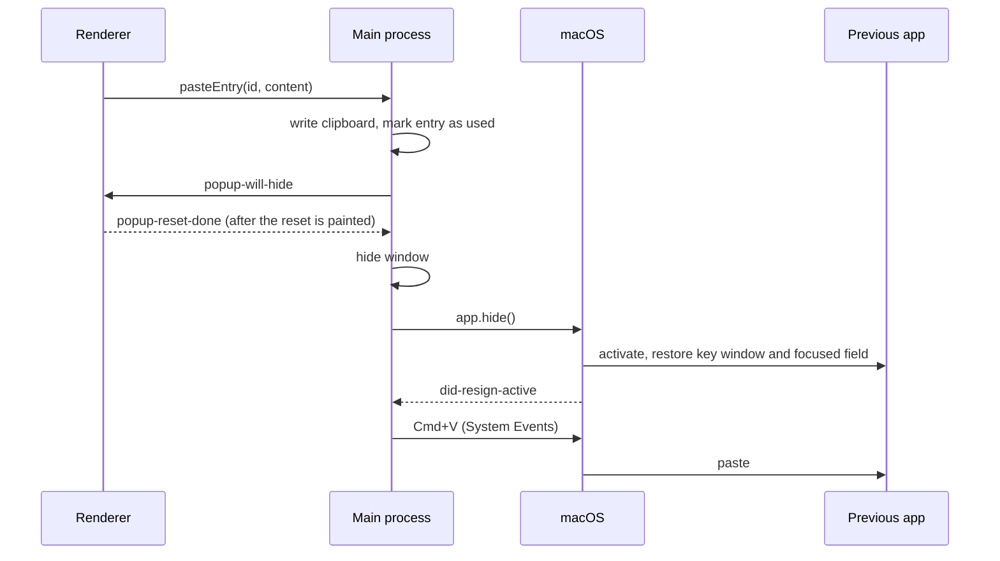

# Faster opening and reliable auto-paste

This document explains two changes to Clippo, why they were needed, how they were designed and
how they were verified:

1. **The popup felt slow to open.** It is now driven by a main process that is never blocked on
   the hot path, and the renderer is lighter and fully offline.
2. **Clicking an entry did not paste it into the text field you were typing in.** Clippo now
   hands focus back to the previous app using the native macOS mechanism, waits for macOS to
   confirm the switch, and only then sends Cmd+V.

It is written so it can be read on its own, for example to prepare a technical interview.

---

## TL;DR

| Metric (Linux, Xvfb, Electron 28, median of 9 cold starts) | Before | After | Change |
| --- | ---: | ---: | ---: |
| History UI rendered, ms after process start | 568 | 379 | **-33%** |
| Final fonts applied (no more font swap), ms | 866 | 399 | **-54%** |
| History UI rendered when offline, ms | 464 | 361 | -22% |
| Processes at startup | 5 | 4 | -1 renderer |
| Memory at startup (working set) | 545 MB | 414 MB | **-24%** |

| Main thread cost (same machine, same Electron process) | Before | After | Change |
| --- | ---: | ---: | ---: |
| Hotkey handler before the window is shown | blocking `osascript` (*) | 0 ms of blocking work | removed |
| Clipboard poll tick with a 2880x1800 screenshot on the clipboard | 246.8 ms | 41.8 ms | **-83%** |
| Recording one copy with 500 entries in history | 3.67 ms (sync write) | 0.06 ms | **-98%** |
| Hiding the popup (paste, Esc) | fixed 80 ms timer | 13 to 38 ms (renderer handshake) | about -60% |
| Image row payload sent to the renderer | full-size PNG as base64 (MBs) | 640 px thumbnail (2.6 KB in the test) | orders of magnitude |
| Production `node_modules` shipped inside `app.asar` | 57.5 MB | 0 MB | -100% |

(*) `osascript` cannot run in the Linux benchmark environment, so this one was not measured here.
It spawns a process, starts the AppleScript runtime and talks to System Events; it is commonly
in the 100 to 300 ms range and the old code allowed up to 1 s. Run `CLIPPO_PERF=1 npm start` on a
Mac to see the new `hotkey.toggle` and `popup.show` timings.

---

## How it was measured

Measurements matter more than intuition for performance work, so the first step was to build
reproducible benchmarks and capture a baseline **before** changing any code. The scripts are
committed so anyone can rerun them.

* `scripts/perf/startup-probe.js` is preloaded into Electron with `-r`. It records, relative to
  process start: `app.ready`, page load, the moment the history list is in the DOM, the moment
  `document.fonts.ready` resolves, the number of processes and their memory.
* `scripts/perf/bench-startup.sh` (`npm run bench:startup`) launches the built app N times with a
  fresh profile and prints medians. One warm-up run is discarded (cold disk cache).
  `--host-resolver-rules="MAP * ~NOTFOUND"` simulates being offline.
* `scripts/perf/main-thread-bench.js` loads the **old and new** compiled modules side by side in
  one Electron process and times the clipboard poll tick and the cost of recording a copy.
* `src/main/platform/perf.ts` adds opt-in timing logs on the real hot paths (`CLIPPO_PERF=1`).

Caveat: the numbers above come from a Linux container (Xvfb, software rendering). macOS absolute
values will differ, but every root cause below is platform independent except the AppleScript
calls, which only make the macOS picture worse for the old version.

---

## Part 1: why opening was slow, and the fixes

The Electron **main process is single threaded**. It receives the global shortcut, shows the
window, answers IPC calls from the UI, polls the clipboard and writes files. Anything slow in any
of those delays everything else, including the reaction to the hotkey. Most of the slowness came
from work that blocked this thread.

### 1. A synchronous AppleScript ran before the popup could appear

The hotkey handler first ran
`execSync("osascript -e 'tell application \"System Events\" to get name of ...'")`
to remember the frontmost app, and only then toggled the window. `execSync` freezes the main thread
until the child process exits.

**Fix:** the handler now only toggles the window. The app name is no longer needed at all because
focus restoration works differently (see Part 2).

### 2. The clipboard poller re-encoded images every 500 ms

Electron has no clipboard change event, so Clippo polls. Each tick did
`clipboard.readImage().toPNG()` and hashed the result, even when nothing had changed. Decoding a
Retina screenshot and re-encoding it to PNG costs about **247 ms per tick**, so with a screenshot
on the clipboard the main thread was busy roughly half of the time, and a hotkey press often had
to wait behind a tick. On a change, the image was then read and encoded a second time.

**Fix** (`src/main/clipboard/imageFingerprint.ts`):

* Check `availableFormats()` first (0.1 ms). No image format means no image work at all.
* Hash the **raw encoded bytes** the pasteboard already holds (`readBuffer('public.png')` on
  macOS) instead of decoding: length plus the first and last 64 KB.
* Why sampling is safe for PNG: pixel data is a zlib stream, and a zlib stream ends with an
  **Adler-32 checksum of all uncompressed data**. Any pixel change changes the tail, so the tail
  is a sound identity check. Formats without such a checksum (TIFF, raw bitmaps) are hashed in
  full; decoding is only a fallback.
* Ticks are chained with `setTimeout` instead of `setInterval`, so a slow tick can never overlap
  the next one.
* When a new image is detected it is decoded and encoded **once**.

Result: **246.8 ms to 41.8 ms** per tick in the benchmark. The remaining cost is copying the bytes
out of the pasteboard. The definitive fix would be a tiny native module reading
`NSPasteboard.changeCount`, which turns an idle tick into a single integer comparison (see
"Future work").

### 3. Every copy rewrote the whole history synchronously

`insertEntry` serialized the full history, encrypted it, wrote it with `writeFileSync` and rebuilt
an "index" twice. The index mapped full lowercase content to ids and was scanned linearly anyway,
so it cost memory and time without making search faster.

**Fix** (`src/main/storage/persistentJsonStore.ts`), one generic store used by history, settings
and groups (it also removed three copies of the same load/encrypt/migrate code):

* Mutations are applied in memory and a write is **debounced** (bursts become one write).
* Writes are **asynchronous and atomic**: write `file.tmp`, then `rename`. A crash mid-write can
  no longer corrupt the history.
* Writes are **serialized** through a promise chain so they never interleave.
* Pending changes are flushed synchronously on `will-quit`.
* An unreadable file is **backed up** before defaults are used, instead of silently being
  overwritten (the old code would replace the history with an empty one if decryption failed
  once).
* Legacy plain-text files are still migrated to encrypted storage transparently.
* The useless index was dropped; search is a simple filter over at most a few hundred entries.

Result: recording a copy went from **3.67 ms to 0.06 ms** of main-thread time.

### 4. A render-blocking request to Google Fonts

`styles.css` started with `@import url('https://fonts.googleapis.com/...')`. A CSS `@import` blocks
rendering until it is downloaded, then the font files are fetched, then text re-renders with the
new font (a visible "flash" and layout shift). Offline, the request has to fail first.

**Fix:** fonts are bundled with `@fontsource` packages, imported from `main.tsx`, limited to the
Latin subset and the five weights actually used. The CSP no longer allows remote style or font
origins, which is also a security improvement.

Result: fonts final at **399 ms instead of 866 ms**, UI rendered **33% earlier**, and the app looks
identical offline.

### 5. Stale frame on open, and a fixed 80 ms hide timer

The code had a `TODO: the view is refreshing after opening the popup and not before`. Two causes:

* A hidden `BrowserWindow` is **throttled** by Chromium by default: timers are delayed and frames
  are not produced. The UI reset that was triggered while hiding only really happened after the
  next show, so you saw the old frame, then the refresh.
* Hiding waited a fixed 80 ms and hoped React had finished.

**Fix** (`src/main/windows/popupWindow.ts` and `App.tsx`):

* `backgroundThrottling: false` on the popup, which must be ready to show instantly.
* A small **handshake**: main sets opacity to 0 (still composited, so Chromium keeps painting),
  sends `popup-will-hide`; the renderer resets its state, reloads the list (pasting moved the
  entry to the top), waits two animation frames so the new state is painted, and replies
  `popup-reset-done`; main hides. A 150 ms timeout guarantees the window always hides.
* `hide()` is idempotent and shared, so blur, Esc and paste cannot race each other.

Result: hiding takes **13 to 38 ms** instead of 80 ms, and the next open shows the fresh state on
the first frame (verified by the end-to-end test).

### 6. Image rows loaded full-size images over IPC

"Thumbnails" were full-size copies of the screenshot, read and base64-encoded on the main thread
every time a row mounted. With a few screenshots in history, opening the popup moved megabytes
through IPC.

**Fix** (`src/main/clipboard/imageStore.ts`): real thumbnails (640 px wide, enough for the 350 px
row on Retina) created with `nativeImage.resize`. Thumbnails written by old versions are
regenerated once on demand (versioned file name). The test screenshot's row payload is 2.6 KB.

### 7. Smaller startup work

* The **tooltip window is created lazily**. Every `BrowserWindow` is a separate renderer process;
  most sessions never show the tooltip. Startup goes from 5 to 4 processes and from 545 MB to
  414 MB.
* The **history file is loaded at startup** (disk read and Keychain decryption), right after the
  window starts loading, instead of during the first open.
* The popup is created once, hidden, and reused, so opening is just "position and show".
* All renderer libraries are bundled by Vite, so they moved to `devDependencies`, and unused ones
  (Chakra UI, Emotion, Framer Motion, react-window) were removed. The packaged `app.asar` no longer
  contains 57.5 MB of `node_modules` the app never loads.
* `LSUIElement` is set in the packaged `Info.plist`, so macOS treats Clippo as a menu bar app from
  the first frame (no Dock icon flash).
* A **single instance lock** prevents a second launch from creating a second tray icon and a
  second clipboard poller.

---

## Part 2: pasting into the text field you were using

### Why it did not work

The intended flow was: click an entry, the popup closes, the entry is pasted where you were
typing. The old code wrote the clipboard, hid the window and sent Cmd+V with AppleScript.

The problem is **which app is active** at that moment. Showing the popup activates Clippo. Hiding
its window does **not** deactivate the app: Clippo is still the frontmost application, just with
no visible window. So Cmd+V was delivered to Clippo, and nothing happened in your text field.

There was a function meant to fix this (`restoreFocusAndPaste`, which re-activated the captured
app by name), but it was never called. It also had two problems of its own: it interpolated the
app name into a shell string (command injection if an app name contains a quote) and used
`execSync` (blocking).

### The design



Key decisions (`src/main/paste/`):

* **Use the native focus handback.** `app.hide()` maps to `NSApplication.hide(_:)`. When an app
  hides, macOS reactivates the app that was active before it, and that app restores its own key
  window and first responder. The caret returns to the exact text field, not just the app. No need
  to remember any app name, no AppleScript to switch apps.
* **Event driven, not timer driven.** `ElectronAppActivation` tracks `did-become-active` and
  `did-resign-active` (direct mappings of NSApplication notifications). The paste waits for
  `did-resign-active`, bounded by a 500 ms safety timeout, instead of sleeping a magic number of
  milliseconds. The listener is registered **before** calling `app.hide()` so the event cannot
  be missed.
* **Fail safe.** If focus does not come back in time, Clippo does not send Cmd+V (it could land in
  the wrong place); the entry stays on the clipboard. The IPC call returns a typed
  `PasteResult`: `pasted`, `copied` (for example no Accessibility permission) or `failed`.
* **Serialized.** A double click queues the second paste behind the first instead of interleaving
  two hide/focus/keystroke sequences.
* **Esc and the close button** use the same focus handback without pasting, so dismissing the
  popup also puts you back where you were.
* **No shell.** All macOS commands use `execFile` with an argument array, asynchronously.
* **No duplicates.** After Clippo writes to the clipboard it tells the watcher to remember that
  content, so a paste is not recorded again as a new entry (this was a real bug for images).

### Alternatives considered

| Option | Why not (for now) |
| --- | --- |
| Remember the frontmost app name, re-activate it with AppleScript | Slow (process spawn on the hotkey path), restores the app but relies on it to restore the field, injection risk. This is what the old code half did. |
| Non-activating panel (`type: 'panel'`, like Spotlight): Clippo never steals activation, so no handback is needed | Best possible UX, but Electron's panel support had keyboard and focus issues around this Electron version. Worth revisiting after an Electron upgrade. |
| Native module posting a `CGEvent` for Cmd+V | Only needs Accessibility. Clippo now gets the same result without a native build step by posting the `CGEvent` from a JavaScript for Automation script (see Part 3). |

### Permissions

Sending a keystroke requires **Accessibility** permission (System Settings, Privacy and Security,
Accessibility). Without it the entry is still copied and `PasteResult` is `copied`. The permission
check uses the native `systemPreferences.isTrustedAccessibilityClient(false)` instead of
spawning `osascript`. Part 3 explains why this permission kept "disappearing".

---

## Part 3: auto-paste still failed on a real Mac

After the release, opening was fast but auto-paste still did nothing on a real install, even though
Clippo was listed and switched **on** in System Settings, Accessibility. Removing Clippo from the
list and adding it again fixed it immediately. That symptom points to the root cause.

### Root cause: an ad-hoc signature changes with every build

macOS stores privacy grants (TCC) against an app's **designated requirement**, a rule derived from
its code signature. Clippo was released without a signing certificate, so the build was only
*ad-hoc* signed. An ad-hoc designated requirement is essentially "the binary whose hash is X".
Every new build has a new hash, so after an update macOS sees a different app: the old toggle is
still displayed as ON, but it belongs to the previous binary and is no longer honoured.
`isTrustedAccessibilityClient` returns false and synthesized keystrokes are dropped silently.

A second, related problem: the paste keystroke went through
`tell application "System Events" to keystroke "v"`. That is an Apple Event to System Events, which
needs the **Automation** permission on top of Accessibility. macOS only asks for it when the
responsible app declares `NSAppleEventsUsageDescription` in its Info.plist, and Electron's default
Info.plist does not (verified in the Electron 28 macOS bundle). Packaged Clippo was refused without
a prompt (error -1743), while `npm start` worked because Terminal was the responsible app. This is
why paste "worked on my machine" during development.

### Fixes

1. **Sign every build with the same certificate** (`scripts/mac/sign.js`, an electron-builder
   `afterPack` hook). With a certificate, the designated requirement becomes
   `identifier "com.clippo.app" and certificate leaf = H"<certificate hash>"`, which is identical
   for every release, so the Accessibility grant survives updates. The certificate is a free
   self-signed one created once with `openssl` (RSA key, `codeSigning` extended key usage, exported
   as a .p12); CI imports it from two
   repository secrets into a throwaway keychain. Without the secrets (forks, local builds) the hook
   falls back to ad-hoc signing and logs a warning. The build log prints the designated
   requirement so it can be compared across releases.
2. **Detect the problem in the app** (`src/main/paste/accessibilityNotice.ts`). Before sending
   Cmd+V, `PasteService` checks `isTrustedAccessibilityClient(false)`. If it is false, Clippo
   still returns focus to the previous app (so a manual Cmd+V works), asks macOS to show its
   permission prompt once per session, and posts a notification explaining the "remove and add it
   again" step, which the system prompt does not mention. Clicking it opens the right settings
   pane. This replaces a silent failure with an actionable message.
3. **Post the keystroke as a CGEvent** (`src/main/platform/macos.ts`). A tiny JavaScript for
   Automation script calls `CGEventCreateKeyboardEvent` / `CGEventPost` for Cmd+V (virtual key 9),
   which needs only Accessibility, no Automation permission. The System Events script is kept as a
   fallback, and `NSAppleEventsUsageDescription` is now declared so that fallback (and the
   ignored-apps check) can prompt instead of failing silently.
4. **Wait for focus to settle.** macOS reports `did-resign-active` as soon as Clippo deactivates,
   but the previous app makes its window key on its own run loop. A 50 ms pause before posting
   the keystroke avoids racing it. It is injected into `PasteService`, so tests do not wait on it.

### Trade-offs

* A self-signed certificate keeps permissions stable but does **not** satisfy Gatekeeper: users
  still right-click, Open on first launch. The complete fix is an **Apple Developer ID**
  certificate (99 USD per year) plus notarization, which removes the Gatekeeper warning too. The
  signing hook already takes any identity name, so switching is a secrets change.
* Moving from ad-hoc to the certificate changes the designated requirement **once**, so users
  re-grant Accessibility one last time on the first signed release.
* The private key lives only in repository secrets and in the file the maintainer keeps. Losing it
  means a new certificate, which costs users one more re-grant.

### Interview angle

"It works on my machine" had a precise explanation: in development the responsible process was
Terminal, which already had the right permissions and usage strings, while the shipped app had an
identity that changed on every build. Reading how TCC identifies apps (designated requirements)
turned a vague "permissions are flaky" into a one-line signing fix plus in-app detection.

---

## Architecture after the refactor

```
src/main/
  index.ts                  Composition root: creates and wires every object, owns the app lifecycle
  ipc.ts                    IPC handlers: validate input, delegate, only accept the popup's webContents
  preload.ts                contextBridge API (sandboxed)
  encrypting.ts             Keychain-backed StorageCodec (safeStorage)
  permissionChecker.ts      Native permission checks
  storage/
    persistentJsonStore.ts  Debounced, atomic, encrypted JSON document store
    historyRepository.ts    Clipboard history domain logic (no Electron imports)
    settingsRepository.ts   Settings with runtime validation
    groupRepository.ts      Groups
    historyImport.ts        Import validation
    guards.ts               Type guards for untrusted data
  clipboard/
    clipboardWatcher.ts     Change detection loop (no Electron imports)
    imageFingerprint.ts     Cheap image identity (no Electron imports)
    imageStore.ts           Image files and real thumbnails
  paste/
    appActivation.ts        Activation tracking and focus handback (NSApplication events)
    pasteService.ts         The paste sequence (no Electron imports)
  windows/
    popupWindow.ts          The long-lived popup and its hide handshake
    tooltipWindow.ts        Lazily created tooltip
  platform/
    macos.ts                execFile wrappers: keystroke, frontmost app, settings deep link
    perf.ts                 Opt-in timing logs
```

Principles applied:

* **Dependency injection with a single composition root.** Classes receive their collaborators
  through the constructor; only `index.ts` knows the concrete Electron implementations. This is
  what makes the domain logic testable without launching Electron.
* **Domain logic free of Electron.** `HistoryRepository`, `ClipboardWatcher`, `PasteService` and
  `fingerprintClipboardImage` depend on small interfaces (`DocumentStore`, `AppActivation`, a
  clipboard subset), not on Electron modules.
* **Validate at trust boundaries.** Data from disk, from imported files and from the renderer is
  parsed with type guards (`parseHistoryData`, `parseSettings`, `requireId`...) rather than cast.
* **Security hardening on the way:** `sandbox: true` for both windows, IPC handlers reject calls
  not coming from the popup, no shell execution, stricter CSP.

---

## Verification

* **Type checking** for main, renderer and tests: `npm run typecheck`.
* **41 unit tests** (`npm test`, Vitest) covering the store (atomic write, migration, backup,
  flush on quit), history rules (dedupe, pinning, eviction with image cleanup, search, caps),
  settings validation, import, the image fingerprint, the clipboard watcher and the paste
  sequence. They use fakes and in-memory stores, and **no fake timers**: the code was designed so
  that time-dependent parts are injectable or event driven.
* **End-to-end smoke test** of the real built app (`xvfb-run -a npm run test:e2e`, 12 checks):
  only one window at startup, live list updates, search, click writes the clipboard, popup hides
  after the renderer handshake (not the timeout), opacity restored, next open is fresh, no
  duplicate after paste, image recorded once with a real thumbnail, Escape dismisses.
* **CI**: a new `test` job runs type checking, unit tests and the e2e smoke test on every push and
  pull request, and the macOS packaging job now depends on it.

### Manual check on macOS (what CI cannot do)

Keystroke synthesis and focus handback need a real macOS session with Accessibility permission:

1. `npm run dist`, install, grant Accessibility to Clippo.
2. Type in TextEdit, press the hotkey, click an entry: it is inserted at the caret in TextEdit.
3. Same in a browser text field and in a terminal.
4. Press the hotkey, then Esc: the caret is back in the previous field.
5. Revoke Accessibility, click an entry: the popup closes and Cmd+V by hand pastes it.
6. `CLIPPO_PERF=1 open -a Clippo` (or `CLIPPO_PERF=1 npm start`) and watch the `[perf]` lines.

---

## Trade-offs and limitations

* Polling is still polling. Idle ticks are cheap now, but an image sitting on the clipboard still
  costs a raw byte read per tick.
* Writes are debounced (250 ms). If the process is killed with `SIGKILL` within that window, the
  last copy is lost; a normal quit flushes synchronously.
* `backgroundThrottling: false` keeps the hidden popup's renderer awake. It does almost nothing
  while hidden, but it is a conscious choice of responsiveness over idle CPU.
* Auto-paste still goes through `osascript` for the keystroke itself, after the popup is closed,
  so it is off the "open" hot path.

## Future work

1. Native addon for `NSPasteboard.changeCount` (idle poll becomes free) and `CGEventPost` (faster
   paste, one fewer permission).
2. Upgrade Electron (28 is out of support) and evaluate `type: 'panel'`.
3. Bundle the preload with Vite so IPC channel names have a single source of truth.
4. Virtualize the list if the visible cap ever grows beyond a few hundred rows.

---

## Interview talking points

* **Measure first.** I built a startup probe and a main-thread benchmark and captured a baseline
  before touching code, then compared old and new modules in the same process.
* **Find what blocks the main thread.** In Electron the main process is single threaded; the
  biggest wins were removing synchronous `osascript`, an image re-encode every 500 ms, and
  synchronous whole-file writes from the hot path.
* **Know the platform.** The paste bug was a misunderstanding of macOS activation: hiding a window
  does not deactivate the app. The fix uses `NSApplication.hide` and activation notifications
  instead of timers and AppleScript.
* **Prefer events over sleeps.** Both the hide (renderer handshake) and the paste (resign-active
  event) wait for a signal, with a timeout only as a safety net.
* **Use domain knowledge for cheap correctness.** Sampling a PNG is safe because zlib ends with an
  Adler-32 of all pixel data; the same trick would be wrong for TIFF, so TIFF is hashed in full.
* **Leave the code better.** One generic atomic store instead of three copies, dependency
  injection, validation at trust boundaries, sandboxed renderers, tests and CI.
