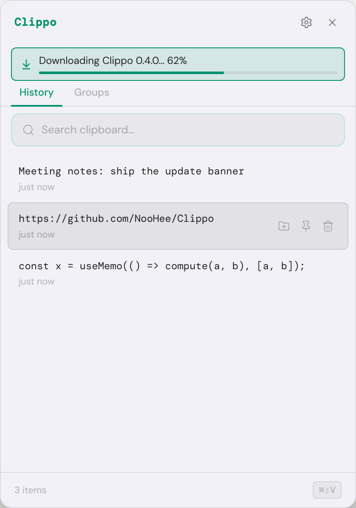

# In-app updates

This document explains how Clippo finds out that a new version exists, how it tells the user, and
how one click on **Update** downloads the new version, installs it and restarts the app. It builds
on the automated release pipeline in [release-process.md](release-process.md): every release is a
GitHub Release tagged `vX.Y.Z` with the macOS builds attached.

## TL;DR

- The app asks the public GitHub REST API for the latest release 30 seconds after launch and then
  every 6 hours, and compares its tag with `app.getVersion()` using Semantic Versioning rules.
- When a newer release exists, the user sees it in three places: a native macOS notification (once
  per version per session), a banner at the top of the popup, and an item at the top of the menu bar
  icon's menu.
- **Update** (banner, tray item, notification click or Settings) downloads the new `.zip` with
  [electron-updater](https://www.electron.build/auto-update), checks its SHA-512, hands it to
  Squirrel.Mac (Electron's native updater), which replaces the app bundle and relaunches Clippo.
  The banner shows the download progress, then "Clippo will restart".
- If anything in that chain fails, the app keeps running and the button turns into **Download**,
  which opens the right build for the user's Mac in the browser. Development builds and other
  platforms only ever show **Download**.
- *What's new* opens the release notes. The **×** skips that version for good. Settings has an
  *Updates* section (automatic check toggle, running version, *Check now*), and the menu bar menu
  has *Check for Updates…*.
- Squirrel.Mac only installs an update signed with the same identity as the running app. Clippo is
  signed with a stable self-signed certificate (not an Apple Developer ID), which satisfies that
  check but is not a setup Apple documents, hence the automatic fallback. See
  [Signing and its trade-offs](#signing-and-its-trade-offs).

| Update offered | Downloading | Settings > Updates |
| -------------- | ----------- | ------------------ |
|  |  |  |

## Flow

### Finding an update

```
             app launch                                    every 6 h
                 |                                             |
                 v                                             v
     UpdateService.start() --30 s--> scheduled tick ---> checkNow() <--- "Check now" (Settings)
                                          |                    ^   <--- "Check for Updates…" (tray)
                       checks disabled?  -+-> skip, reschedule |
                                                               |
                         GitHubReleaseSource.latest()  ---------+
                         GET api.github.com/repos/NooHee/Clippo/releases/latest
                         If-None-Match: <last ETag>   (304 = unchanged, free)
                                          |
                                          v
                     parseRelease(): validate JSON, drop drafts/pre-releases,
                     keep only https://github.com URLs
                                          |
                     isNewerVersion(tag, app.getVersion())
                           /                          \
                       no /                            \ yes
                         v                              v
                  "up-to-date"                 "available" + pickDownloadUrl(arch)
                                                        |
                       status pushed to the renderer (banner, Settings) and tray menu
                       notification once per version, unless the user skipped it
```

### Installing it

```
 click "Update"
      |
      v
 UpdateService.install()            state: downloading (0..100 %)
      |
      v
 ElectronUpdaterInstaller.download(version)
   - import('electron-updater') the first time (not at startup)
   - checkForUpdates(): reads latest-mac.yml from the same GitHub Release
   - refuses if it is not the version the user was shown
   - downloadUpdate(): fetches Clippo-X.Y.Z[-arm64]-mac.zip, verifies its SHA-512
      |
      v                             state: installing ("Clippo will restart")
 installAndRestart() -> autoUpdater.quitAndInstall()
   - Squirrel.Mac checks the new app's code signature against the running app's
     designated requirement, swaps the bundle, relaunches Clippo
   - error event, or still running after 2 minutes -> reject
      |
      v
 any failure: state available + installFailed -> button becomes "Download"
```

## Code map

| File | Responsibility |
| ---- | -------------- |
| `src/main/updates/version.ts` | SemVer parsing and ordering (`0.10.0 > 0.9.0`, `1.0.0 > 1.0.0-rc.1`). |
| `src/main/updates/githubReleases.ts` | Calls the GitHub API, validates the response, picks the asset for the CPU architecture, caches by ETag. |
| `src/main/updates/updateInstaller.ts` | `UpdateInstaller` interface and its electron-updater implementation: version check, download with progress, install with error and timeout handling. |
| `src/main/updates/updateService.ts` | The rules: when to check, deduplicating concurrent checks, what the result means, when to notify, skipped versions, the install state machine and its fallback. No Electron import. |
| `src/main/updates/updateNotifications.ts` | Notification texts (English, French), pure. |
| `src/main/tray/trayMenu.ts` | The tray menu, now with the update item (Update, Download, or progress). Pure. |
| `src/main/index.ts` | Composition root: wires `net.fetch`, electron-updater, timers, settings, `Notification`, `shell.openExternal` and the tray into the service. |
| `src/main/ipc.ts` | Five handlers: get status, check now, install, open a link, skip the version. |
| `src/renderer/hooks/useUpdateStatus.ts` | Reads the status once and follows the changes main pushes. |
| `src/renderer/components/UpdateBanner.tsx` | The banner: offer, progress bar, restarting, fallback. |
| `src/renderer/components/SettingsPanel.tsx` | The *Updates* section. |
| `src/shared/types.ts` | `UpdateStatus` (a discriminated union on `state`), `AvailableUpdate`, the two new settings. |
| `package.json` (`build`) | `publish` (GitHub) so electron-builder writes `latest-mac.yml` and embeds `app-update.yml`; a `.zip` for both architectures, since Squirrel.Mac installs from a zip. |
| `.github/workflows/release.yml` | Uploads `latest-mac.yml` and the `.blockmap` files with the builds, and fails if `latest-mac.yml` does not describe the tagged version. |

`UpdateStatus` is a discriminated union
(`idle | checking | up-to-date | available | downloading | installing | error`), so the UI can only
read `update.version` or `percent` once TypeScript has narrowed the state. Impossible combinations,
such as "checking, with a download progress", cannot be represented. `canInstall` sits on every
state, so the UI knows whether to offer **Update** or **Download** without asking main again.

## Design choices worth calling out

### Two sources, one decision

The update check uses a small client of the GitHub API (about 350 lines, no dependency), and the
install uses electron-updater. Why not let electron-updater do both?

- **Startup cost.** An earlier change removed `node_modules` from `app.asar` to make the popup open
  faster (see [performance-and-auto-paste.md](performance-and-auto-paste.md)). electron-updater and
  its dependencies add about 2 MB of JavaScript. The background check never loads them;
  `import('electron-updater')` runs only when the user clicks **Update**.
- **A fallback that does not depend on the thing that failed.** If the install path breaks (missing
  `latest-mac.yml`, signature mismatch, app running from a read-only location), the GitHub check
  still knows the release and can offer the download.
- **Consistency.** Before downloading, the installer checks that electron-updater found exactly the
  version the user was shown. It never installs something the UI did not offer.

### Failure is a normal path

Every step of the install can fail on a user's machine, so failures are part of the state machine
instead of exceptions that leak:

- Download errors (offline, 404 on `latest-mac.yml`) and Squirrel errors (signature) all land in
  `available` with `installFailed: true`, and the UI switches to **Download**.
- `quitAndInstall()` gives no callback on success, since the process exits. The installer waits for
  an `error` event or a 2 minute timeout; still running after that means the install did not happen.
- While `downloading` or `installing`, scheduled checks, *Check now* and repeated clicks are
  ignored, so nothing can overwrite the progress or start a second download.

### Nothing on the startup path

The first check runs 30 seconds after launch and timers are `unref()`'d, so updating never competes
with opening the popup. Unpackaged runs (`npm run dev`, the e2e test) never call GitHub on their own
and cannot install in place; *Check now* still works there for manual testing.

### Polite to the GitHub API

- Anonymous requests are limited to 60 per hour per IP. Clippo makes 4 per day.
- The `ETag` of the last answer is sent back as `If-None-Match`. When nothing changed, GitHub replies
  `304 Not Modified` without a body, and 304 responses do not count against the limit.
- Requests send the required `User-Agent` (`Clippo/<version>`) and pin `X-GitHub-Api-Version`.
- A 10 second timeout (`AbortSignal.timeout`) means a hanging connection cannot leave the status
  stuck on "checking".

### Security

- **Integrity of the update.** electron-updater verifies the SHA-512 listed in `latest-mac.yml`,
  and Squirrel.Mac refuses an app whose signature does not match the running one, so a tampered zip
  or a build signed by someone else is never installed.
- **The renderer never chooses a URL.** The GitHub response is untrusted input. `parseRelease` keeps
  only `https://github.com/...` links, and `openUpdateLink` checks again right before
  `shell.openExternal`. The renderer can only ask for `'download'` or `'release-notes'` (validated in
  `ipc.ts`) or for `install`; URLs and versions come from main's own validated status. A compromised
  renderer or a tampered response cannot make Clippo open a `file://` path, a custom URL scheme or
  another website.
- The IPC handlers keep the existing rule that only the popup's `webContents` may call them.

### Testable without fake timers, a network or a Mac

`UpdateService` receives the release source, the installer, a `schedule(callback, delay)` function,
the clock, settings getters and notification callbacks through its constructor. Tests use a manual
scheduler that fires callbacks explicitly, a fake source with queued answers, and a fake installer
whose download and install the test settles, so every intermediate state is observable. No
`vi.useFakeTimers()`. `ElectronUpdaterInstaller` depends on an `AutoUpdaterLike` interface (the five
members it uses), so its tests drive a fake that emits `download-progress` and `error`.
`GitHubReleaseSource` takes a `fetch`-shaped function, so its tests use real `Response` objects for
200, 304, 403, 404 and 502.

### Robust scheduling

- Chained one-shot timers rather than `setInterval`: the next check is scheduled only after the
  current one finishes, so a slow network can never stack up requests.
- Concurrent callers (the schedule plus a click on *Check now*) share one in-flight promise.
- The *automatic checks* setting is read on every tick, so turning it off or on needs no restart.
- If a later check fails (offline, rate limited), an update that was already found stays visible.

### User experience

- One notification per version per session, never for a version the user skipped. Clicking it
  starts the update (or opens the download where installing is not possible), which is what its text
  says. Skipping is stored in the settings file (`skippedUpdateVersion`) and survives restarts; a
  newer release shows up again.
- Download progress is reported in whole percents, so the UI re-renders at most 100 times.
- The *Download* fallback targets the right architecture, because picking between a `.dmg` and a
  `-arm64-mac.zip` on a release page is a common source of "the app does not start" reports.
- Everything is translated (English, French): the banner and Settings through i18next, the tray and
  notifications through small string tables in the main process.

## Signing and its trade-offs

On macOS, Squirrel.Mac **only installs an update whose code signature satisfies the running app's
designated requirement**. Every build is signed with the same self-signed certificate
(`scripts/mac/sign.js`, see [performance-and-auto-paste.md](performance-and-auto-paste.md)), so the
requirement is `identifier "com.clippo.app" and certificate leaf = H"<hash>"` for every release. The
new version satisfies the old one's requirement, which is what Squirrel checks. The same stability
keeps the Accessibility permission that auto-paste needs across updates.

| Option | What the user gets | Cost and risk |
| ------ | ------------------ | ------------- |
| Notify and link to the download | A prompt and the right file one click away; they drag the app into Applications. | Free and simple. One manual step. Still the fallback. |
| **electron-updater with the self-signed certificate** (chosen) | One click: download, install, restart. | Free. Not a setup Apple documents, so it is backed by the automatic fallback. Losing the private key means users on the old certificate must download the next version manually. Gatekeeper still warns on the very first install. |
| electron-updater + Developer ID and notarization | Same one click, plus no Gatekeeper warning on first launch. | Apple Developer Program (99 USD per year), notarization in CI. The signing hook takes any identity, so switching is a secrets change plus a notarization step. |
| Custom self-updater (download, unzip, replace the bundle, relaunch) | One click. | Reimplements Squirrel, so its safety depends on getting the signature check right. Fragile (permissions, app translocation). |

Two things to know when releasing:

- **The first release with this feature is installed manually.** Versions before it cannot update
  themselves; from that version on, **Update** works.
- **Release order.** release-please publishes the GitHub Release, then the `publish` job uploads the
  files a minute or two later. A user who clicks **Update** in that window gets the **Download**
  fallback, which is harmless.

## How it was verified

- **Unit tests** (`npm test`): 72 tests in the update and tray modules, for the version rules, the GitHub client (headers,
  ETag/304, 404, 403, 502, malformed payloads, untrusted URLs, asset choice per architecture), the
  service (notify once, skip, error after success, shared in-flight check, schedule, toggle, install
  progress, both fallbacks, no double install), the electron-updater adapter (lazy load, automatic
  behaviour off, version guard, progress, error and timeout), the tray item and the notification
  texts.
- **End-to-end** (`npm run test:e2e`): the real built app with GitHub stubbed at `net.fetch`. It
  checks that an unpackaged run sends no request on its own and offers only **Download**, that
  *Check now* calls the right endpoint with the right `User-Agent`, that Settings and the banner show
  the new version, that *Download* opens the build for the machine's architecture, that skipping
  hides the banner and is saved, and that the install states render: **Update**, the progress bar,
  "will restart", and the fallback to **Download**.
- **Real electron-updater, real files.** `electron-builder --mac zip --publish never` (run on Linux,
  unsigned) produced `Clippo-0.3.0-mac.zip`, its `.blockmap` and `latest-mac.yml`, and embedded
  `app-update.yml` in the bundle. A test app pretending to be 0.2.0 pointed electron-updater's
  `MacUpdater` at those files: `ElectronUpdaterInstaller` refused version 0.4.0 (not what the feed
  offered), then downloaded and SHA-512 verified 0.3.0 and reported progress up to 100 %.
- **Against the real API**: the compiled `GitHubReleaseSource` and `UpdateService`, run through
  Electron's `net.fetch`, against `NooHee/Clippo`. Pretending to be `0.2.1` gives `up-to-date`;
  pretending to be `0.2.0` gives `available` with the arm64 zip on arm64 and the dmg on x64. The
  second request returned `304 Not Modified`, confirming the ETag cache.
- **Not verifiable in CI:** the Squirrel.Mac step (signature check, bundle swap, relaunch) needs two
  signed releases on a real Mac. That is the manual check below; the fallback covers it if it fails.

### Manual check on a Mac

1. Install the first release that contains this feature (manually, as usual) and grant Accessibility.
2. When the next release is published, within 30 seconds a notification says
   *Clippo X.Y.Z is available, click to update*.
3. Open the popup: the banner shows **Update**. Click it: a progress bar fills, the banner says
   Clippo will restart, the app quits and comes back on the new version (Settings > Updates shows it).
4. Paste an entry: auto-paste still works without re-granting Accessibility.
5. If step 3 ends with **Download** instead, the install failed. The downloaded zip is in
   `~/Library/Caches/clippo-updater`, and Squirrel's log is in
   `~/Library/Caches/com.clippo.app.ShipIt/ShipIt_stderr.log`.
6. Tray menu > *Check for Updates…* on the newest version shows *Clippo is up to date*.
