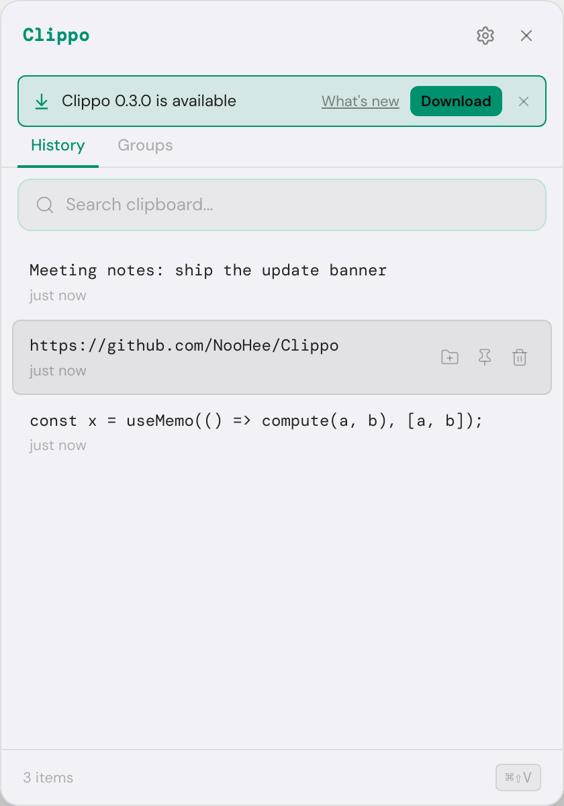
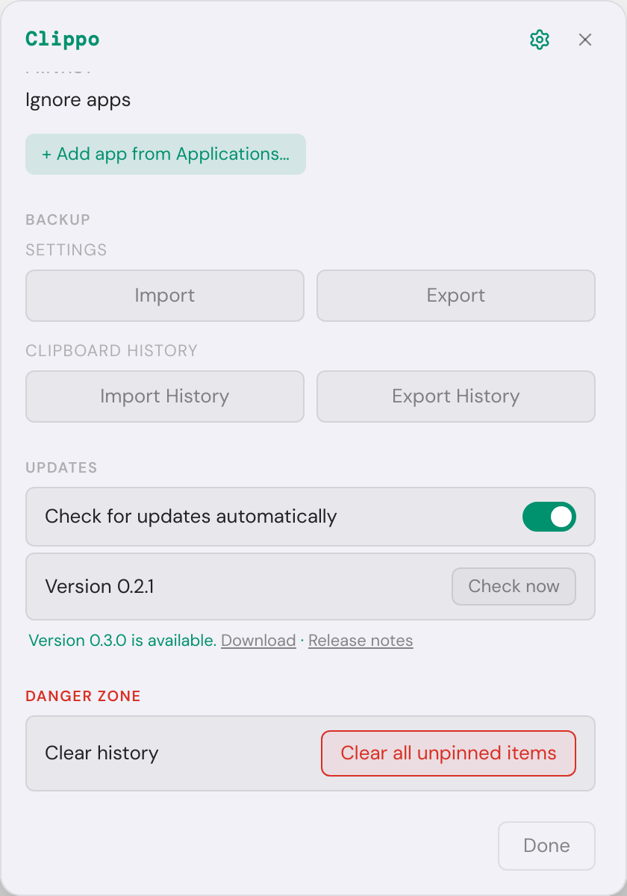

# Update notifications

This document explains how Clippo finds out that a new version exists, how it tells the user, and
why it does not (yet) install updates by itself. It builds on the automated release pipeline in
[release-process.md](release-process.md): every release is a GitHub Release tagged `vX.Y.Z` with the
macOS builds attached.

## TL;DR

- The app asks the public GitHub REST API for the latest release 30 seconds after launch and then
  every 6 hours, and compares its tag with `app.getVersion()` using Semantic Versioning rules.
- When a newer release exists, the user sees it in three places: a native macOS notification (once
  per version per session), a banner at the top of the popup, and a *Download Clippo X.Y.Z…* item at
  the top of the menu bar icon's menu.
- *Download* opens the build for the user's Mac (`-arm64-mac.zip` on Apple Silicon, `.dmg` on Intel)
  in the browser. *What's new* opens the release notes. The **×** skips that version for good.
- Settings has an *Updates* section: an automatic check toggle, the running version and a
  *Check now* button. The menu bar menu has *Check for Updates…*.
- Clippo is not code signed, and macOS only lets an app replace itself when it is. So the app
  **notifies and links to the download** instead of installing silently. The section
  [Why not electron-updater](#why-not-electron-updater-yet) explains the trade-off and the upgrade
  path.

| Popup banner | Settings > Updates |
| ------------ | ------------------ |
|  |  |

## Flow

```
             app launch                                    every 6 h
                 |                                             |
                 v                                             v
     UpdateService.start() --30 s--> scheduled tick ---> checkNow() <--- "Check now" (Settings)
                                          |                    ^   <--- "Check for Updates…" (tray)
                       checks disabled?  -+-> skip, reschedule |
                                                               |
                         GitHubReleaseSource.latest()  ---------+
                         GET api.github.com/repos/NooHee/Clippo/releases/latest
                         If-None-Match: <last ETag>   (304 = unchanged, free)
                                          |
                                          v
                     parseRelease(): validate JSON, drop drafts/pre-releases,
                     keep only https://github.com URLs
                                          |
                     isNewerVersion(tag, app.getVersion())
                           /                          \
                       no /                            \ yes
                         v                              v
                  "up-to-date"                 "available" + pickDownloadUrl(arch)
                                                        |
                       status pushed to the renderer (banner, Settings) and tray menu
                       notification once per version, unless the user skipped it
```

## Code map

| File | Responsibility |
| ---- | -------------- |
| `src/main/updates/version.ts` | SemVer parsing and ordering (`0.10.0 > 0.9.0`, `1.0.0 > 1.0.0-rc.1`). |
| `src/main/updates/githubReleases.ts` | Calls the GitHub API, validates the response, picks the asset for the CPU architecture, caches by ETag. |
| `src/main/updates/updateService.ts` | The rules: when to check, deduplicating concurrent checks, what the result means, when to notify, skipped versions. No Electron import. |
| `src/main/index.ts` | Composition root: wires `net.fetch`, timers, settings, `Notification`, `shell.openExternal` and the tray menu into the service. |
| `src/main/ipc.ts` | Four handlers: get status, check now, open a link, skip the version. |
| `src/renderer/hooks/useUpdateStatus.ts` | Reads the status once and follows the changes main pushes. |
| `src/renderer/components/UpdateBanner.tsx` | The banner in the history view. |
| `src/renderer/components/SettingsPanel.tsx` | The *Updates* section. |
| `src/shared/types.ts` | `UpdateStatus` (a discriminated union on `state`), `AvailableUpdate`, the two new settings. |

`UpdateStatus` is a discriminated union (`idle | checking | up-to-date | available | error`), so the
UI can only read `update.version` once TypeScript has narrowed the state to `available`. Impossible
combinations such as "checking, with an update and an error" cannot be represented.

## Design choices worth calling out

### Zero new dependencies

The checker is about 350 lines of TypeScript (comments included) using Electron's built-in `net.fetch`. An earlier
change removed `node_modules` from `app.asar` to make the popup open faster (see
[performance-and-auto-paste.md](performance-and-auto-paste.md)); `electron-updater` would have added
it back (8 direct dependencies such as `fs-extra`, `js-yaml`, `semver` and `builder-util-runtime`, plus theirs) for a feature the app cannot use
without code signing. The SemVer subset Clippo needs is tested against the ordering example from the
SemVer specification.

### Nothing on the startup path

The first check runs 30 seconds after launch and timers are `unref()`'d, so updating never competes
with opening the popup. Unpackaged runs (`npm run dev`, the e2e test) never call GitHub on their own;
*Check now* still works there for manual testing.

### Polite to the GitHub API

- Anonymous requests are limited to 60 per hour per IP. Clippo makes 4 per day.
- The `ETag` of the last answer is sent back as `If-None-Match`. When nothing changed, GitHub replies
  `304 Not Modified` without a body, and 304 responses do not count against the limit.
- Requests send the required `User-Agent` (`Clippo/<version>`) and pin `X-GitHub-Api-Version`.
- A 10 second timeout (`AbortSignal.timeout`) means a hanging connection cannot leave the status
  stuck on "checking".

### Security: the renderer never chooses a URL

The GitHub response is untrusted input. `parseRelease` keeps only `https://github.com/...` links, and
`openUpdateLink` checks again right before `shell.openExternal`. The renderer can only ask for
`'download'` or `'release-notes'` (validated in `ipc.ts`); the actual URL comes from main's own
validated status. A compromised renderer or a tampered response therefore cannot make Clippo open a
`file://` path, a custom URL scheme or another website. The IPC handlers keep the existing rule that
only the popup's `webContents` may call them.

### Testable without fake timers or a network

`UpdateService` receives the release source, a `schedule(callback, delay)` function, the clock,
settings getters and notification callbacks through its constructor. Tests pass a manual scheduler
that records callbacks and fires them explicitly, and a fake source with queued answers, so the tests
are deterministic, instant and need no `vi.useFakeTimers()`. `GitHubReleaseSource` takes a
`fetch`-shaped function, so its tests use real `Response` objects for 200, 304, 403, 404 and 502.

### Robust scheduling

- Chained one-shot timers rather than `setInterval`: the next check is scheduled only after the
  current one finishes, so a slow network can never stack up requests.
- Concurrent callers (the schedule plus a click on *Check now*) share one in-flight promise.
- The *automatic checks* setting is read on every tick, so turning it off or on needs no restart.
- If a later check fails (offline, rate limited), an update that was already found stays visible
  instead of disappearing.

### User experience

- One notification per version per session, never for a version the user skipped. Skipping is
  stored in the settings file (`skippedUpdateVersion`), so it survives restarts; a newer release
  shows up again.
- The *Download* link targets the right architecture, because a user picking between a `.dmg` and a
  `-arm64-mac.zip` on a release page is a common source of "the app does not start" reports.
- The banner and the Settings texts are translated (English, French). The tray menu and system
  notifications are in English, like the rest of the tray menu today.

## Why not electron-updater (yet)

`electron-updater` with the GitHub provider is the standard way to ship one-click updates in
Electron: electron-builder publishes a `latest-mac.yml` with each release, the app downloads the new
`.zip` in the background and installs it on quit. On macOS the install step is done by Squirrel.Mac,
which **verifies that the new app is code signed with the same Developer ID as the running one**.
Clippo's builds are not signed (`CSC_IDENTITY_AUTO_DISCOVERY: false` in CI), so that check fails and
the install never happens.

| Option | What the user gets | Cost and risk |
| ------ | ------------------ | ------------- |
| **Notify and link to the download** (chosen) | A clear "new version available" prompt and the right file one click away. They drag the new app into Applications. | Free, no new dependency, works for unsigned builds. One manual step for the user. |
| electron-updater + Developer ID signing and notarization | Silent background download, installs on quit, no Gatekeeper prompt on first launch. | Apple Developer Program (99 USD per year), certificate and notarization secrets in CI, electron-updater and its dependency tree shipped inside the app. |
| Custom self-updater for unsigned apps (download, unzip, replace the bundle, relaunch) | One click, no Apple account. | Reimplements what Squirrel does without the signature check, so integrity rests on HTTPS alone. Fragile (permissions in `/Applications`, app translocation). And because unsigned or ad hoc signed builds get a new code identity every release, macOS would **forget the Accessibility permission** that auto-paste needs after every update. |

That last point matters for Clippo specifically: auto-paste needs Accessibility access, and macOS
ties that grant to the app's code signature. Only a stable Developer ID signature keeps the
permission across updates. So proper signing is the real prerequisite for seamless updates, not the
updater library.

### Upgrade path once the app is signed

The current design was split so this is a small, local change:

1. Add the Developer ID certificate and notarization credentials as CI secrets and remove
   `CSC_IDENTITY_AUTO_DISCOVERY: false` from the `build` job.
2. Add `"publish": { "provider": "github" }` to the electron-builder config and upload
   `release/latest-mac.yml` and the `.blockmap` files in the `publish` job, next to the `.dmg` and
   `.zip`.
3. Add `electron-updater` and implement the download and install behind the same `UpdateStatus`
   (new states such as `downloading` and `ready-to-install`). The banner's *Download* button becomes
   *Restart to update*. `UpdateService`, the IPC contract and the UI stay.

## How it was verified

- **Unit tests** (`npm test`): 48 tests for the version rules, the GitHub client (headers, ETag/304,
  404, 403, 502, malformed payloads, untrusted URLs, asset choice per architecture) and the service
  (notify once, skip, error after success, shared in-flight check, schedule, toggle).
- **End-to-end** (`npm run test:e2e`): the real built app with GitHub stubbed at `net.fetch`. It
  checks that an unpackaged run sends no request on its own, that *Check now* calls the right
  endpoint with the right `User-Agent`, that Settings and the banner show the new version, that
  *Download* opens the build for the machine's architecture, and that skipping hides the banner and
  is saved.
- **Against the real API**: the compiled `GitHubReleaseSource` and `UpdateService`, run through
  Electron's `net.fetch`, against `NooHee/Clippo`. Pretending to be `0.2.1` gives `up-to-date`;
  pretending to be `0.2.0` gives `available` with `Clippo-0.2.1-arm64-mac.zip` on arm64 and
  `Clippo-0.2.1.dmg` on x64. The second request returned `304 Not Modified`, confirming the ETag cache.

### Manual check on a Mac

1. Install an older release (for example `v0.2.1` once `v0.3.0` exists) and launch it.
2. Within 30 seconds a notification says *Clippo 0.3.0 is available*. Clicking it opens the download.
3. Open the popup: the banner is at the top. *What's new* opens the release page.
4. Click **×**: the banner disappears and stays gone after a restart. Settings > Updates still
   lists the version.
5. Tray menu > *Check for Updates…* on the newest version shows *Clippo is up to date*.
